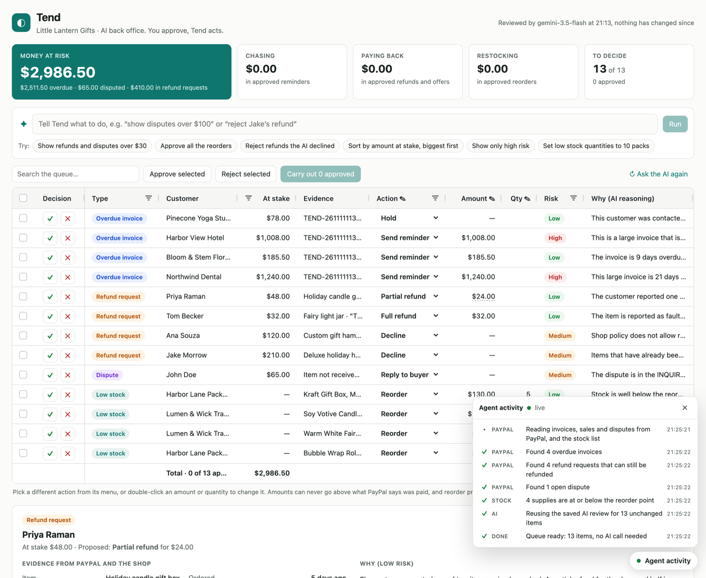

# Tend

**An AI back office for small PayPal sellers. You approve, Tend acts.**

Tend reads a seller's PayPal account and finds the money problems that need attention: overdue invoices, refund requests, open disputes and low stock. It asks Gemini what to do about each one. Then it puts every proposal into an **AG Grid approval queue**. The owner approves, edits or rejects each row, or tells the agent what to do in plain English. Tend carries out only the approved rows, through PayPal.

**Live demo:** https://tend-145u.onrender.com (free hosting: the first visit can take about a minute to wake up)
**Demo video:** _added at submission_



---

## The problem

A one-person shop on PayPal juggles four different screens every week:

- Business customers who haven't paid their invoices
- Shoppers asking for refunds (some fair, some not)
- Disputes opened with PayPal
- Supplies running low

Each one means reading the details, deciding what's fair, and clicking through PayPal. Tend gathers them into one queue, has an AI do the reading and the first draft, and leaves the owner one job: deciding.

## How it works

1. **Gather.** The server reads overdue invoices, open disputes and refundable sales from the PayPal sandbox, plus the shop's stock list.
2. **Review.** Gemini gets every item with the shop's policy (for example "a broken item gets a refund for the broken part" and "change of mind gets an exchange, not a refund"). For each item it proposes an action, a reason, a risk level and a message to the customer.
3. **Check.** Code, not the AI, sets the money. Reminders and full refunds use PayPal's exact amount. Partial refunds are capped at what was paid. Reorder prices come only from the supplier catalog.
4. **Decide.** The owner works through the AG Grid queue, or types commands like *"show refunds and disputes over $30"* or *"reject Jake's refund and approve all the reorders"*.
5. **Act.** "Carry out" builds a plan from fresh PayPal data. The owner confirms it, and Tend sends the reminders, refunds and dispute replies to PayPal. Reorders are paid with PayPal Checkout. Every row then shows ✓ Done, Failed (with PayPal's reason) or waiting for payment.

A live **Agent activity** panel shows each step as it happens: reading PayPal, which Gemini model answered, what the money rules checked, and every PayPal action.

## How Tend uses AG Grid

The approval queue is one AG Grid (Community edition), and the AI operates it through the Grid API.

| Feature | How Tend uses it |
|---|---|
| **The agent drives the grid** | Typed commands become Grid API calls: `setFilterModel` for filters, `applyColumnState` for sorting, an **external filter** (`isExternalFilterPresent` / `doesExternalFilterPass`) to show only rows the AI picked, and `flashCells` on the cells a command changed |
| **Undo** | Before each command, Tend saves `getFilterModel()`, `getColumnState()` and the row data, so one click puts everything back |
| **Read-only edit mode** | `readOnlyEdit` + `onCellEditRequest`: every edit goes through the same money rules as the server before it reaches React state, so typing $9,999 on a $48 sale gives $48 |
| **Per-row editing** | Amount is editable only for partial refunds and dispute offers, and Qty only for reorders (`editable` callbacks, number cell editors) |
| **Custom cell renderers** | Approve/reject buttons, type badges, risk pills, a per-row action menu that lists only actions valid for that row, and PayPal result tags |
| **Row styling** | `rowClassRules` for approved, rejected, done and failed rows |
| **Pinned totals row** | `pinnedBottomRowData` with the total at stake and the total approved |
| **Selection** | Multi-row checkbox selection for bulk approve and reject |
| **Filters and search** | Text and number column filters with up to four conditions, plus a quick-filter search. `refData`, `filterValueGetter` and `getQuickFilterText` let you filter and search actions by their label |
| **Theming** | The Theming API (`themeQuartz.withParams`), tooltips, and fixed row heights for steady zooming |
| **Immutable data** | `getRowId` with React state, so the grid updates only rows that changed |

## AI (Gemini) and its guardrails

- **One request for the whole queue.** Gemini returns structured JSON (a response schema), not free text.
- **Typed commands** become grid operations, which the server checks against the real rows and columns before the browser applies them.
- **The AI only proposes.** Money rules live in one shared module (`shared/actions.js`) that both the server and the browser use.
- **Customer text is treated as evidence, never as instructions** (protection against prompt injection). The money caps catch anything that gets through.
- **Busy models:** if a model is overloaded, Tend tries the next one (Gemini 3.5 Flash → 3 Flash Preview → 2.5 Flash). If all are busy, it reuses the last good review, and simple rules cover anything new.
- **Saving calls:** a saved review is reused for unchanged items, so only new or changed items are sent to Gemini.

## PayPal (sandbox only)

| PayPal API | Used for |
|---|---|
| Invoicing v2 | Finding overdue invoices, sending reminders |
| Payments v2 (captures, refunds) | Checking sales, full and partial refunds |
| Disputes v1 | Reading disputes and their messages; reply, make offer, accept claim |
| Orders v2 + PayPal Checkout | Paying for approved reorders |

**Safety when carrying out:**
- **The server sets the amounts.** It re-fetches every approved row from PayPal and re-prices it. The browser's numbers are only suggestions.
- **Only a confirmed plan runs, and only once.** Plans expire after 10 minutes.
- **No double refunds.** Each PayPal request ID is derived from the row, action and amount, so sending the same refund twice can't refund twice.
- **Passcode on the hosted demo.** "Carry out" needs an owner passcode, and the rate limits protect the AI key.

## Try it

Open **https://tend-145u.onrender.com** and:

1. Look at the money at risk, then click a row to see its evidence and the AI's reasoning.
2. Open **Agent activity** (bottom right).
3. Type a command: *"show refunds and disputes over $30"*, then *"sort by amount at stake, biggest first"*, then **Undo**.
4. Change Priya's action or amount, approve a few rows, and press **Carry out** to see the plan.

**For judges:** the owner passcode for "Carry out" and the PayPal sandbox buyer login for paying reorders are in the Devpost submission notes. Carrying out really changes the shared sandbox data, for example refunds can't be undone.

## Run it locally

**You need:**
- Node.js 22.12 or newer
- A PayPal sandbox app with **Invoicing** enabled ([developer.paypal.com](https://developer.paypal.com) → Apps & Credentials → Sandbox)
- A Gemini API key ([aistudio.google.com](https://aistudio.google.com))

```bash
git clone https://github.com/jaryalarshita/tend.git
cd tend
npm install
cp .env.example .env     # then fill in your keys
npm run seed             # fills YOUR sandbox with the demo shop's invoices and sales
npm run dev              # open http://localhost:5173
```

The first load asks Gemini to review your new demo items, which takes up to a minute.

| Variable | Needed | What it is |
|---|---|---|
| `PAYPAL_CLIENT_ID` | Yes | Sandbox app client ID |
| `PAYPAL_CLIENT_SECRET` | Yes | Sandbox app secret |
| `GEMINI_API_KEY` | Yes | Gemini API key |
| `GEMINI_MODEL` | No | Put a different model first in the fallback order |
| `OWNER_PASSCODE` | No | If set, "Carry out" asks for it (set it on any public deployment) |

| Command | What it does |
|---|---|
| `npm run dev` | Server (port 3001) and page (port 5173) together, with reload |
| `npm run seed` | Creates demo invoices (some overdue) and paid sales. Add `-- --reset` to cancel the old demo invoices first |
| `npm run snapshot` | Saves the current AI review as `server/data/review-snapshot.json`, so a fresh start needs no Gemini call |
| `npm run build` then `npm start` | Production build, served by the Node server (as on Render) |

**Disputes** can't be created through PayPal's API. To get one, pay a sandbox order with the sandbox **Personal** account, then report a problem in the sandbox Resolution Center. It shows up in Tend after a few minutes.

**Deploying:** `render.yaml` is a ready Render Blueprint. Point Render at the repo and fill in the four secrets.

## Project layout

```
server/          Node + Express: PayPal client, data sources, Gemini review and commands,
                 the plan / carry-out executor, action history, live activity stream
shared/          Money and action rules, used by the server and the browser
client/src/      React + AG Grid: the queue, command bar, detail panel, carry-out dialog
scripts/         Sandbox seeding and the review snapshot
server/data/     Supplier catalog, stock list, demo sales and the committed AI review snapshot
```

## Built with

React 19, Vite, AG Grid Community 36, Node.js and Express, the Google Gen AI SDK (Gemini), the PayPal REST APIs and PayPal Checkout, hosted on Render.


## License

[MIT](LICENSE)
